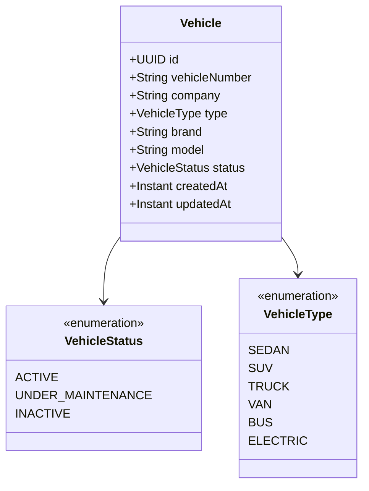

# Vehicle Management System (VMS) — Backend Service (`vms-backend`)

Enterprise backend REST API service for the Vehicle Management System (VMS), providing robust fleet management, relational SQL persistence, strict business validation, and clean RESTful endpoints.

---

## 1. Architectural Role & Repository Isolation

The Vehicle Management System is designed as a decoupled, multi-repository architecture:

```
┌─────────────────────────────────┐           ┌─────────────────────────────────┐
│          vms-frontend           │           │           vms-backend           │
│       (Flutter Web / Dart)      │   HTTP    │     (Java / Spring Boot / SQL)   │
│  • Material 3 Enterprise UI     │ ◄───────► │  • RESTful API Endpoints        │
│  • Desktop-First Layout         │   REST    │  • Business Rules & Validation  │
│  • Independent Repository       │   JSON    │  • SQL Relational Persistence   │
└─────────────────────────────────┘           └─────────────────────────────────┘
```

> [!IMPORTANT]
> **Strict Separation of Concerns:**
> - `vms-backend` is dedicated exclusively to server-side logic, API design, database schema, and transaction integrity.
> - No Flutter, Dart, or frontend UI files reside in this repository.
> - The frontend is maintained in an independent repository (`vms-frontend`).

---

## 2. Planned Technology Stack

| Layer | Component | Planned Version / Details |
|---|---|---|
| **Runtime Environment** | Java (JDK) | Java 21 LTS (or Java 17 LTS) |
| **Application Framework** | Spring Boot | Spring Boot 3.x (Spring Framework 6.x) |
| **REST & Web Services** | Spring Web | Spring MVC, Jackson (JSON serialization), Problem Details (RFC 7807) |
| **Persistence / ORM** | Spring Data JPA | Hibernate 6.x, Spring Data Repositories |
| **Database** | Relational SQL | PostgreSQL / MySQL / H2 (testing profile) |
| **Data Validation** | Jakarta Validation | Hibernate Validator (`@NotNull`, `@NotBlank`, `@Size`, custom validators) |
| **API Documentation** | OpenAPI 3 | Springdoc-OpenAPI / Swagger UI |
| **Build & Dependency Tool** | Apache Maven / Gradle | Maven Wrapper (`mvnw`) or Gradle Wrapper (`gradlew`) |
| **Testing Framework** | Testing Suite | JUnit 5, Mockito, AssertJ, Spring Boot Test, Testcontainers |
| **Deployment / Container** | Containerization | Multi-stage Dockerfile, Docker Compose |

---

## 3. Planned Core Responsibilities

### 3.1. Vehicle Lifecycle Management
- Centralized tracking of fleet inventory and operational readiness.
- Managed status transitions:
  - `ACTIVE`: Vehicle is operational and in-service.
  - `UNDER_MAINTENANCE`: Vehicle is undergoing inspection, scheduled service, or repair.
  - `INACTIVE`: Vehicle is retired, decommissioned, or temporarily out of service.

### 3.2. Vehicle Registration
- Capture and validate new fleet assets with mandatory attributes:
  - Registration number (`vehicleNumber`)
  - Operating company (`company`)
  - Vehicle classification (`type`: Sedan, SUV, Truck, Van, Bus, Electric)
  - Manufacturer / Brand (`brand`)
  - Model name / Series (`model`)
  - Initial operational status (`status`)
- Auto-generation of unique persistent identifier (`id`) and audit timestamps (`createdAt`, `updatedAt`).

### 3.3. Duplicate Vehicle Number Validation
- Enforce strict uniqueness on the `vehicleNumber` field.
- **Service Layer Validation:** Pre-flight check rejecting duplicate license/registration plates (case-insensitive and trimmed).
- **Database Layer Constraint:** `UNIQUE` index constraint on the `vehicle_number` column to guarantee integrity under concurrent write operations.
- **Error Response:** Returns standardized HTTP `409 Conflict` (or `422 Unprocessable Content` / `400 Bad Request`) with actionable problem details.

### 3.4. Vehicle Updates
- Full updates (`PUT /api/v1/vehicles/{id}`) and partial updates (`PATCH /api/v1/vehicles/{id}`).
- Prevent conflicting duplicate vehicle numbers during updates (excluding the vehicle's own ID from the collision check).
- Automatic audit tracking for modification timestamps (`updatedAt`).

### 3.5. Vehicle Deletion
- Safe removal (`DELETE /api/v1/vehicles/{id}`).
- Verification of resource existence before deletion (returning HTTP `404 Not Found` if non-existent).
- Support for transactional hard deletion or configurable soft deletion (`deleted_at` flag) based on corporate audit retention policies.

### 3.6. SQL Database Persistence
- Relational schema modeling with clear type definitions, primary keys, and index strategies.
- ACID transaction guarantees (`@Transactional`) ensuring data consistency across concurrent requests.
- Optimized query execution for filtering by status, company, and vehicle type.

### 3.7. REST API Endpoints & Contract
- Strict adherence to REST principles with standard HTTP verbs, clean resource-oriented URI paths, and consistent JSON schemas.

---

## 4. Planned REST API Specification

### Base URI Path: `/api/v1/vehicles`

| HTTP Verb | Endpoint Path | Summary | Success Status | Error Codes |
|---|---|---|---|---|
| `GET` | `/api/v1/vehicles` | List vehicles with search, filters, and pagination | `200 OK` | `400 Bad Request` |
| `GET` | `/api/v1/vehicles/{id}` | Retrieve single vehicle details by ID | `200 OK` | `404 Not Found` |
| `POST` | `/api/v1/vehicles` | Register a new vehicle | `201 Created` | `400 Bad Request`, `409 Conflict` |
| `PUT` | `/api/v1/vehicles/{id}` | Update existing vehicle attributes | `200 OK` | `400 Bad Request`, `404 Not Found`, `409 Conflict` |
| `PATCH` | `/api/v1/vehicles/{id}/status` | Update vehicle operational status | `200 OK` | `400 Bad Request`, `404 Not Found` |
| `DELETE` | `/api/v1/vehicles/{id}` | Delete a vehicle record | `204 No Content` | `404 Not Found` |
| `GET` | `/api/v1/vehicles/check-number` | Check if a Vehicle Number is already registered | `200 OK` | `400 Bad Request` |
| `GET` | `/api/v1/vehicles/metrics` | Retrieve fleet count aggregates (Total, Active, etc.) | `200 OK` | `500 Internal Error` |

### Query Parameters for `GET /api/v1/vehicles`
- `query` (optional, string): Case-insensitive search matching vehicle number, company, brand, or model.
- `status` (optional, enum): Filter by `ACTIVE`, `INACTIVE`, or `UNDER_MAINTENANCE`.
- `type` (optional, string): Filter by vehicle category (`SEDAN`, `SUV`, `TRUCK`, `VAN`, `BUS`, `ELECTRIC`).
- `page` (optional, integer, default: 0): Zero-based page index.
- `size` (optional, integer, default: 10): Page size limit.
- `sort` (optional, string, default: `createdAt,desc`): Sorting field and direction.

---

## 5. Planned Domain Data Model



### Relational Table Schema (`vehicles` table)

| Column Name | SQL Type | Constraints | Description |
|---|---|---|---|
| `id` | `VARCHAR(36)` / `UUID` | `PRIMARY KEY` | Unique immutable system identifier |
| `vehicle_number` | `VARCHAR(32)` | `NOT NULL`, `UNIQUE` | License/registration plate identifier |
| `company` | `VARCHAR(128)` | `NOT NULL` | Operating fleet or corporate division |
| `type` | `VARCHAR(32)` | `NOT NULL` | Vehicle classification category |
| `brand` | `VARCHAR(64)` | `NOT NULL` | Manufacturer name |
| `model` | `VARCHAR(64)` | `NOT NULL` | Model / variant designation |
| `status` | `VARCHAR(32)` | `NOT NULL` | Current operational state |
| `created_at` | `TIMESTAMP WITH TIME ZONE` | `NOT NULL` | Record creation audit timestamp |
| `updated_at` | `TIMESTAMP WITH TIME ZONE` | `NOT NULL` | Record last modification audit timestamp |

---

## 6. Planned Project Structure (Target Spring Boot Layout)

When application scaffolding is initiated in future development, it will follow standard Spring Boot multi-tier clean architecture:

```
vms-backend/
├── pom.xml (or build.gradle)
├── mvnw / mvnw.cmd
├── .mvn/
├── .gitignore
├── README.md
└── src/
    ├── main/
    │   ├── java/com/vms/
    │   │   ├── VmsBackendApplication.java
    │   │   ├── common/
    │   │   │   ├── exception/       # GlobalExceptionHandler, ResourceNotFoundException, DuplicateResourceException
    │   │   │   └── response/        # Standard ApiResponse, PagedResponse, ErrorResponse
    │   │   ├── config/              # CorsConfig, OpenApiConfig, SecurityConfig
    │   │   ├── controller/          # VehicleController, MetricsController
    │   │   ├── dto/                 # VehicleRequestDto, VehicleResponseDto, StatusUpdateDto
    │   │   ├── entity/              # Vehicle, VehicleStatus, VehicleType
    │   │   ├── repository/          # VehicleRepository (Spring Data JPA)
    │   │   └── service/             # VehicleService, VehicleServiceImpl
    │   └── resources/
    │       ├── application.yml      # Base application configuration
    │       ├── application-dev.yml  # Local development profile
    │       ├── application-prod.yml # Production profile
    │       └── db/migration/        # Flyway / Liquibase SQL migration scripts
    └── test/
        ├── java/com/vms/
        │   ├── controller/          # VehicleControllerMockMvcTest
        │   ├── repository/          # VehicleRepositoryDataJpaTest
        │   └── service/             # VehicleServiceUnitTest
        └── resources/
            └── application-test.yml # In-memory H2 / Testcontainers configuration
```

---

## 7. Current Repository Status

- [x] Repository initialized with standard Git configuration on branch `main`.
- [x] Comprehensive architectural specification and requirements documented.
- [x] Planned technology stack and database schema documented.
- [x] Spring Boot 3.4 foundation configured with Spring Data JPA, Validation, Web, and PostgreSQL.
- [x] PostgreSQL relational database connection configured with secure environment-based variables.
- [x] Vehicle Domain entity (`Vehicle`), repository (`VehicleRepository`), service (`VehicleService`), DTOs (`VehicleRequest`, `VehicleResponse`), and exception handling (`DuplicateVehicleNumberException`, `ResourceNotFoundException`) implemented.
- [x] Database-level and service-level duplicate vehicle number uniqueness rules strictly enforced and verified.
- [x] Unit test suite covering all vehicle lifecycle operations and duplicate checks passing (18/18 tests passing).
- [ ] Vehicle REST Controllers & API Endpoints (Reserved for designated next phase).
